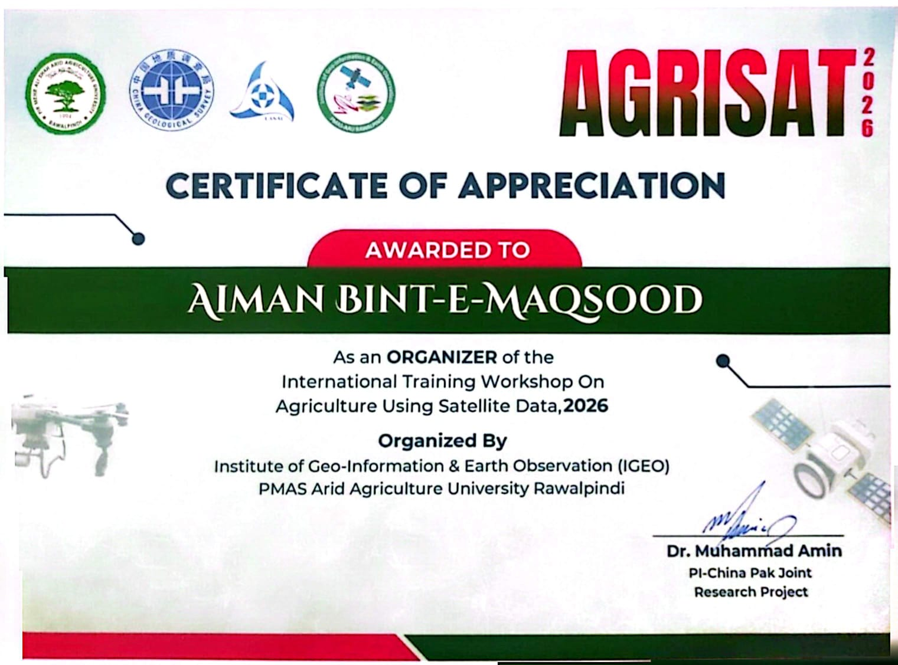

**1. GIS Internship, SpatioCore Tech (June-August 2026)**
[view certificate.pdf](certificate.pdf)
## Overview
Completed a geospatial mapping internship at SpatioCore Tech, Islamabad, Pakistan, from June to August 2026. The work focused on heat vulnerability mapping using GIS and remote sensing data.
## What I worked on
- Heat vulnerability mapping
- [Data used, e.g. Landsat, LST, Indices, population, land cover, Sentinel 2, MODIS, Elevation data, NASA datasets]
- [Methods, e.g. indicator normalization, weighted overlay, zonal statistics]
- [Software, e.g. ArcGIS Pro, Google Earth Engine, Jupyter notebook, Google colab]
## Skills used
GIS and remote sensing, spatial analysis, Land cover/Land use
## Certificate
Issued by SpatioCore Tech, 2026.
## 2. Organizer, International Training Workshop on Agriculture Using Satellite Data (AGRISAT 2026)

Received a Certificate of Appreciation for serving as an **organizer** of the International Training Workshop on Agriculture Using Satellite Data, 2026.

- **Organized by:** Institute of Geo-Information & Earth Observation (IGEO), PMAS Arid Agriculture University Rawalpindi
- **My role:** Supported the hands-on technical sessions and prepared workshop materials
- **Year:** 2026

